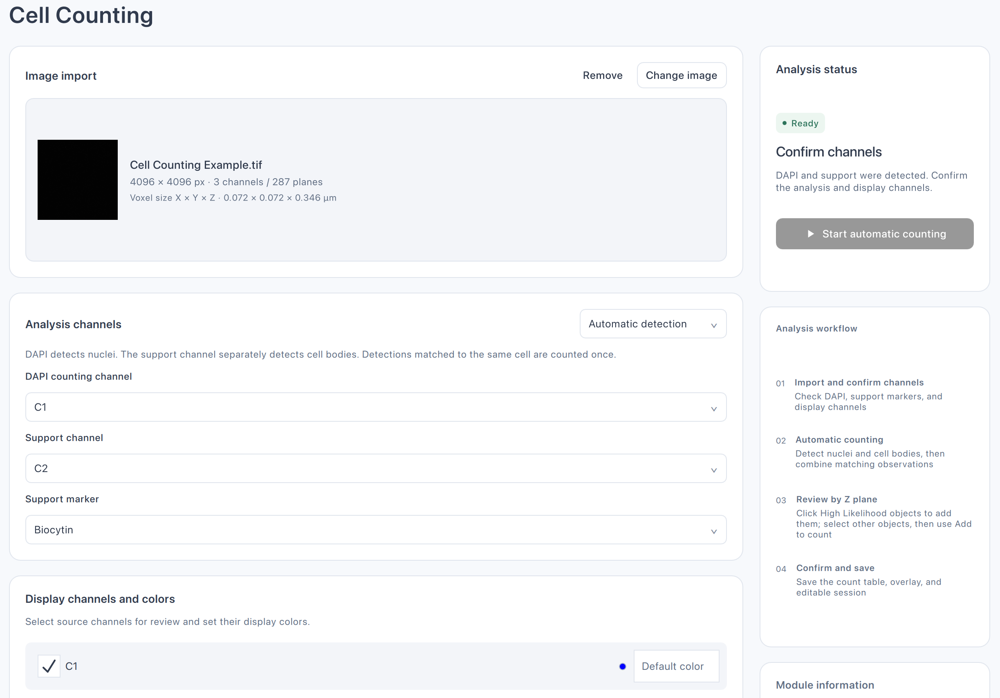

# Project Leap Cell Counting

[English](README.md) · [Project Leap 主站](https://dingchengwang.github.io/Project-Leap/zh/)

Cell Counting 是 **Project Leap** 的细胞空间定位与计数模块，面向多通道荧光 TIFF 图像中的星形胶质细胞。模块使用 DAPI 定位细胞核，并结合用户指定的独立辅助荧光通道识别胞体、判断核周信号。在多层图像中，软件依据原始 Z 层定位细胞，帮助区分二维投影中重叠的细胞。

用户可逐层核对细胞，补加遗漏细胞、合并重复记录、删除错误检测，再确认计数。输出包括带有细胞编号的荧光叠加图、逐细胞 CSV 表格，以及供后续审核的可编辑会话。

Cell Counting **1.0.0** 在 **Project Leap v1.0.0** 内运行。主程序下载见 [Project Leap 下载页面](https://dingchengwang.github.io/Project-Leap/zh/downloads/)。

<!-- leap-media:start counting-input-overview -->

*输入界面显示已导入的图像和通道设置。*
<!-- leap-media:end counting-input-overview -->

## 使用模块

在 Project Leap 内打开**功能与维护**，找到**细胞计数**，点击**安装分析模块**。安装完成后，从侧边栏打开**细胞计数**，再按使用指南选择图像、运行分析并审核计数。

- [使用指南](docs/guide.zh.md)：输入选择、审核操作、保存、重开及输出列说明。
- [方法说明](docs/methods.zh.md)：局部 Z 检测、原始网格恢复、辅助通道胞体识别和细胞身份。
- [细胞记录与标签文件](docs/prototype-d/CELL_IDENTITY.md)：字段和文件格式的精确定义。

## 源码与许可

计数引擎位于 [`engine/leap_cell_counting`](engine/leap_cell_counting)，[`native/counting_stats.c`](native/counting_stats.c) 负责原图统计。桌面界面、模块安装及结果编辑器属于 [Project Leap 主软件](https://github.com/dingchengwang/Project-Leap)。

Project Leap 原创代码采用 [Apache-2.0](LICENSE) 许可，署名见 [NOTICE](NOTICE)。第三方软件和模型权重保留各自许可。固定模型来源为 [MouseLand 的 Cellpose 项目](https://github.com/MouseLand/cellpose)及其[官方 `cpsam_v2` 模型](https://huggingface.co/mouseland/cellpose-sam/blob/main/cpsam_v2)；来源与署名见主软件的[第三方声明](https://github.com/DingchengWang/Project-Leap/blob/main/THIRD_PARTY_NOTICES.md)。
