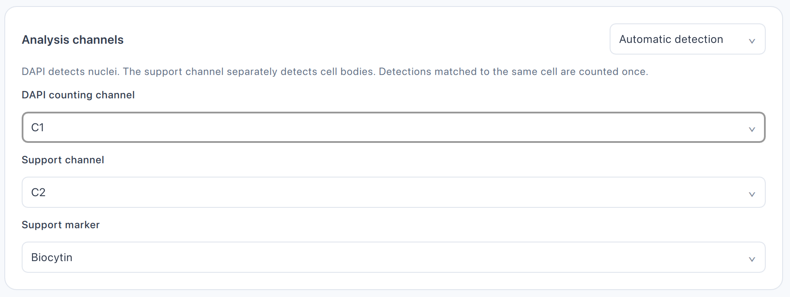
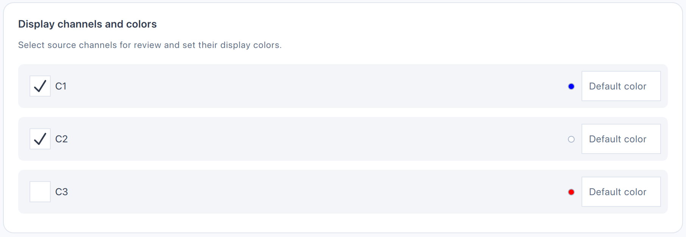
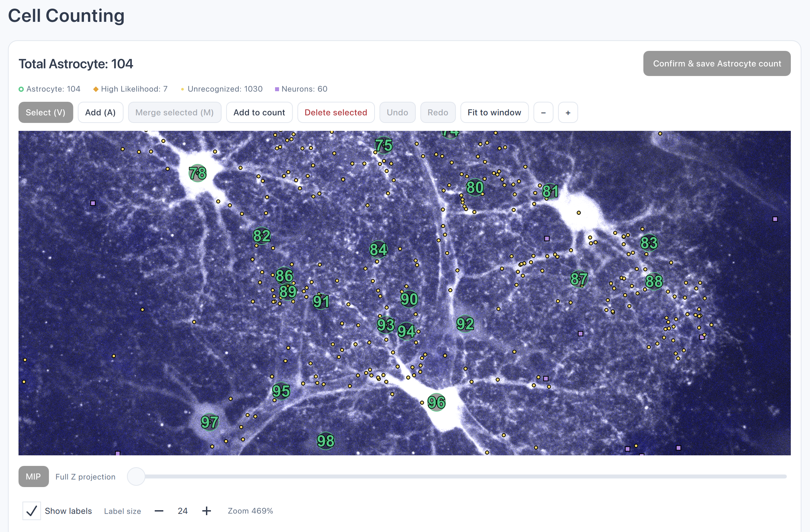
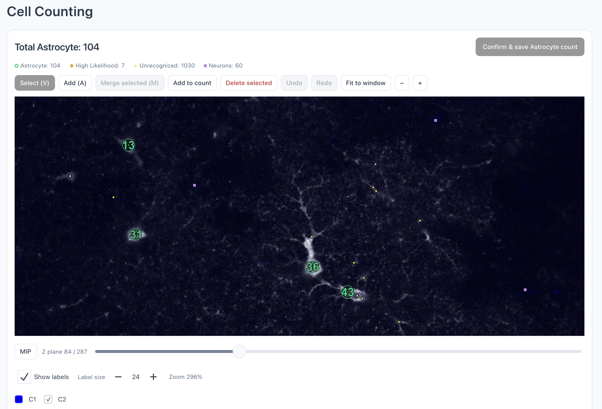

# 细胞计数使用指南

[English](guide.en.md) · [方法说明](methods.zh.md) · [仓库首页](../README_中文.md) · [Project Leap 主站](https://dingchengwang.github.io/Project-Leap/zh/)

本指南适用于 **Project Leap v1.0.0** 内的 Cell Counting **1.0.0** 模块。主程序下载见 [Project Leap 下载页面](https://dingchengwang.github.io/Project-Leap/zh/downloads/)。

## 安装模块并选择图像

1. 在 Project Leap 中打开**功能与维护**，找到**细胞计数**，尚未安装时点击**安装分析模块**。软件会一并安装所需组件。等按钮显示**模块已就绪**后，从侧边栏打开**细胞计数**。
2. 点击**选择图像…**，或将一个 `.tif`、`.tiff` 文件拖入输入区。使用包含 DAPI 和另一种辅助标记物的 8 位或 16 位多通道荧光图像。
3. 文件含多个图像组或时间点时，选择本次要分析的**图像组**和**时间点**。
4. 对照图像确认 **DAPI 计数通道**。软件会尝试自动识别；未识别或选择不正确时，手动指定对应源通道。
5. 选择与 DAPI 不同的**辅助通道**，再选择**辅助标记物**：eGFP、Biocytin、ALDH1L1 或自定义名称。辅助通道用于识别胞体、判断核周信号；通道和标记物均须指定。标记物的评估范围见[方法说明](methods.zh.md#证据适用范围)。
6. 在**显示通道与颜色**中至少选择一个源通道。保留审核时需要比较的 DAPI 和辅助信号通道；在各通道的颜色文本框中填写 `#RRGGBB`，也可留空使用默认颜色。进入审核后，可以切换这些预选通道的显隐。

<!-- leap-media:start counting-analysis-channels -->
<a href="images/counting-analysis-channels.png"></a>

*图中将 C1 选为 DAPI 通道，将 C2 选为 Biocytin 辅助通道。*
<!-- leap-media:end counting-analysis-channels -->

<!-- leap-media:start counting-display-channels -->
<a href="images/counting-display-channels.png"></a>

*图中选择显示 C1 和 C2，不显示 C3。*
<!-- leap-media:end counting-display-channels -->

软件会在运行前自动检查图像及标定。多层图像需要有效的 X/Y/Z 微米标定和方形 XY 采样；只有一个 Z 层的图像需要有效的 X/Y 标定。如果界面提示标定缺失或不兼容，使用包含正确原图元数据的 TIFF。

## 开始分析并逐层查看

点击**开始自动计数**。软件分析所选图像，完成后打开计数编辑器。此时对象已可审核，结果尚未确认保存。

使用 **MIP** 查看整个 Z 堆栈的最大强度投影，再移动 Z 滑块查看原始切片。界面的 Z 层从 1 开始编号。在单层画面中，标记只出现在该对象有已记录位置的层上；MIP 显示全部未删除对象。左上角 **Astrocyte 总数：N** 是整个会话中已接受细胞的总数，不是当前层单独的计数。

投影中出现重叠细胞时，对照原始 Z 层中的各通道核对其位置。判断每个候选对象是否对应细胞、多个记录是否属于同一细胞，以及是否有遗漏细胞需要手动添加。同一细胞可在多个 Z 层显示同一个计数编号。触控板捏合可缩放，滚动或拖动可平移，按 **0** 将图像缩放至适合窗口。

<!-- leap-media:start counting-review-views -->
<a href="images/counting-review-mip.png"></a>

*MIP 视图同时显示已接受的记录和待审核的候选对象。*

<a href="images/counting-review-z-plane.png"></a>

*计数编辑器显示 287 层中的第 84 层，底部提供 Z 滑块和通道开关。*
<!-- leap-media:end counting-review-views -->

## 理解四种标记

| 标记 | 外观 | 编辑器中的含义 | 是否计入总数 |
|---|---|---|---|
| Astrocyte | 绿色编号圈 | 已接受的细胞记录 | 是 |
| High Likelihood | 琥珀色菱形 | 核周辅助信号已通过接受规则，算法设定的 XY 搜索区域边界是唯一剩余限制 | 接受后计入 |
| Unrecognized | 黄色点 | 其余待审核对象 | 接受后计入 |
| Neurons | 紫色方块 | 已排除对象 | 不计入，人工接受后可计入 |

这些名称表示计数状态，生物学细胞身份需结合染色和图像证据判断。

## 调整计数

| 任务 | 操作与结果 |
|---|---|
| 接受单个 High Likelihood | 普通点击该对象，原对象立即加入计数。 |
| 只选择、不接受 | 按住 **Command** 点击对象，切换其选中状态；连续点击可多选，不改变审核状态。 |
| 接受 Unrecognized 或 Neurons | 点击选中对象，再点击**加入计数**。 |
| 批量接受 | Command 点击需要处理的对象，再点击**加入计数**，接受所选待审核或已排除对象。 |
| 添加遗漏细胞 | 按 **A** 或点击**添加 (A)**，再点击图像空白位置；新增人工点立即计数。按 **V** 或**选择 (V)** 返回选择模式。 |
| 将同一细胞的多个记录合并 | Command 选中至少两个对象，按 **M** 或点击**合并所选 (M)**；选择中不能包含 Neurons。父对象全部已接受时，合并记录仍计数；只要包含待审核父对象，合并结果仍待审核，判断适合计入后再使用**加入计数**。 |
| 删除错误记录 | 选中后点击**删除所选**，或按 **Delete**、**Backspace**。对象被隐藏并移出计数；删除不会将它改标为 Neurons。 |
| 撤回编辑 | 使用**撤销**或**重做**；编辑器保留最近最多 100 次编辑历史。 |

需要给人工添加的点指定 Z 层时，应在对应单层画面上添加。在 MIP 上添加的点没有指定 Z，不会自动出现在各单层画面。添加模式下点击已有标记会激活原对象，不会在同处再建一个点。

## 确认保存与重新打开

编辑器会随编辑保存草稿。点击**确认并保存 Astrocyte 计数**后，软件才生成确认结果文件。可以保留 High Likelihood 或 Unrecognized 对象；只有已接受且未删除的对象进入确认计数。保存成功后，编辑器关闭，输入区恢复为可导入新图像的状态；保存失败时，当前审核会话保持打开。重新打开结果后所作的修改仍为草稿，再次确认后才成为新的结果版本。

稍后需要继续时，进入**任务与结果**，展开对应任务。已确认的结果点击**重新打开计数**；未完成审核的任务点击**继续审核计数**。编辑器恢复已保存结果，并在存在草稿时恢复草稿。完成任务可点击**打开结果文件夹**查看文件。切换到另一计数任务前，先确认当前审核。

逐 Z 查看和重新分析需要保留原始 TIFF；逐 Z 查看还需要已安装计数运行环境。原图移动后，可在编辑器中使用**重新定位原图…**，软件会检查替代文件后再使用。原图暂不可用时，仍可查看已保存 MIP 并编辑计数。会话 JSON 会引用任务目录中的其他文件，因此保留可编辑结果时应一起保留任务数据。

## 结果文件

每次确认都在该任务的计数目录下创建一个新版本：

```text
counting/results/
  revision-001/
    Cell_Count_Overlay.png
    Cell_Counts.csv
    Cell_Count_Session.json
  latest.json
```

| 文件 | 内容 |
|---|---|
| `Cell_Count_Overlay.png` | 使用当前显示通道合成的全分辨率 MIP，标出已接受对象的编号；不是当前 Z 层截图。 |
| `Cell_Counts.csv` | 每个已接受、未删除的细胞一行；零细胞结果只有列标题。 |
| `Cell_Count_Session.json` | 保存全部对象、审核状态、删除与合并记录、显示选择、源文件引用和检测依据；重开时需配套任务数据。 |
| `latest.json` | 指向最近一次确认的版本。 |

引擎还会在任务的 `counting` 目录中保留分析结果、标签数组、检测记录和诊断文件，其科学作用见[方法说明](methods.zh.md)。

### CSV 列说明

| 列名 | 含义 |
|---|---|
| `run_id`、`revision` | 任务标识和本次确认版本号。 |
| `count` | 本版本已接受细胞总数，每行重复记录；不要对本列求和。 |
| `display_no` | 编辑器和 PNG 对应的连续计数编号，按代表点 Y/X 顺序重新生成，不是固定标识。 |
| `id`、`cell_id` | 稳定的细胞记录标识；人工合并会生成新标识。 |
| `x`、`y`、`z` | 代表点的原图坐标；X/Y 单位为像素，Z 为从 0 开始的层索引。MIP 上人工添加的点或父对象 Z 不同的合并记录可以没有 Z。 |
| `source` | `auto`：核检测结果；`support_body`：独立胞体；`dapi_support`：关联后的核与胞体；`manual`：人工添加的点；`merged`：人工合并。 |
| `status` | 保存的标注状态；本 CSV 中的行均为 `accepted`。 |
| `label_artifact_id`、`label_id` | 代表掩膜所属标签文件及文件内标签，必须合起来解释；人工记录可以没有这两项。 |
| `plane_anchors`、`plane_anchor_sources` | 逐 Z 层位置，以及提供各位置的检测记录或人工标注点。 |
| `source_observations` | 核或胞体的检测记录、掩膜引用、原图范围及测量证据。 |
| `support`、`association` | 适用时保存的核周辅助信号测量及核—胞体关联记录。 |
| `parent_ids`、`lineage`、`reference_z`、`anchor_parent_id` | 合并来源：直接父对象、祖先 ID、保留的父对象 Z 参考，以及提供代表 XY 锚点的父对象。 |
| `label_ids` | 旧式合并标签引用；包含多份检测记录的细胞，其掩膜身份保存在 `source_observations` 中。 |
| `point_metadata` | 完整对象记录，使用 JSON 保存。 |

结构化列在单个 CSV 单元格内保存 JSON。例如，界面 **Z 第 6 层**对应原图索引 `5`；一个在 `5`、`6`、`7` 层都有锚点的细胞，仍只占一行 CSV，并使 `count` 增加一。
